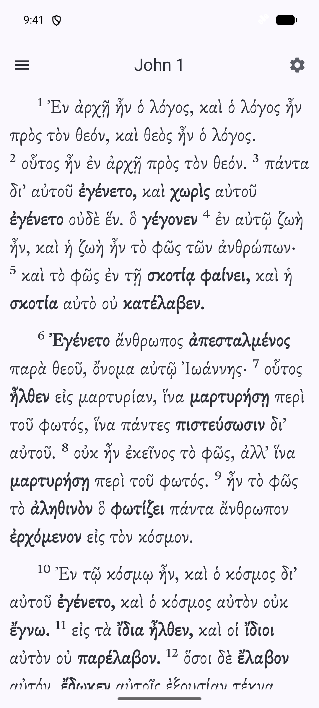
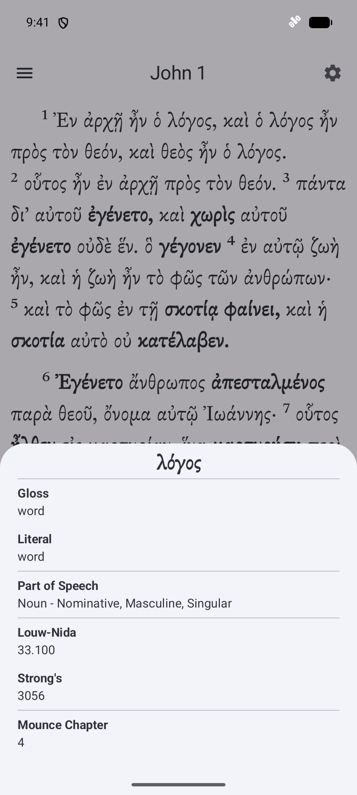
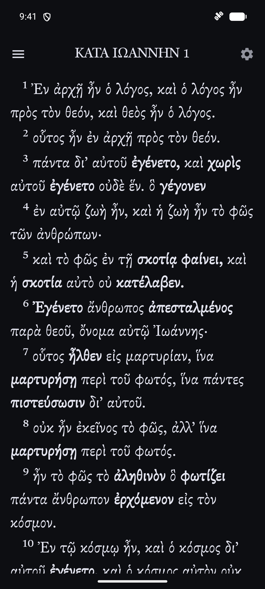
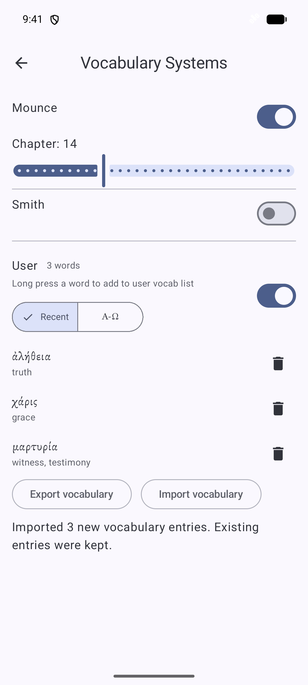
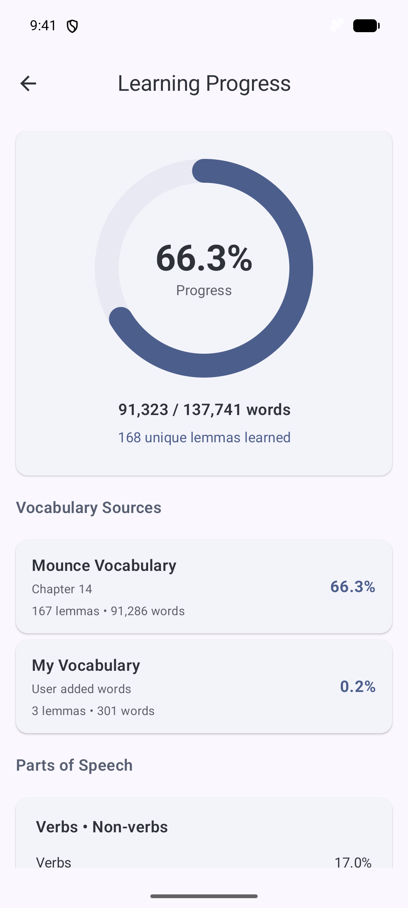
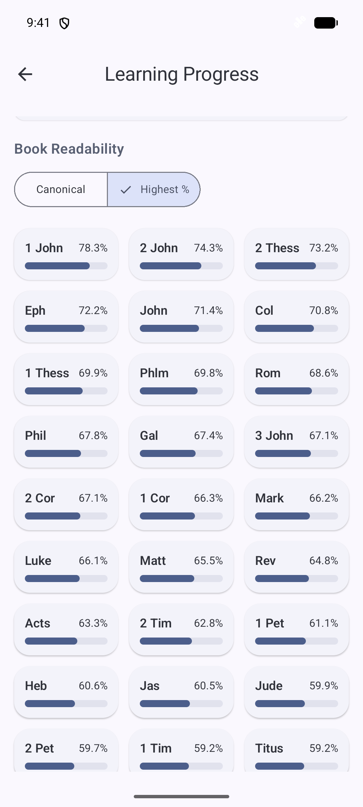
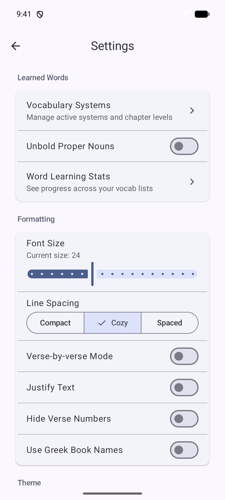
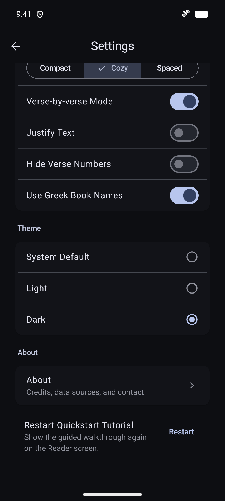
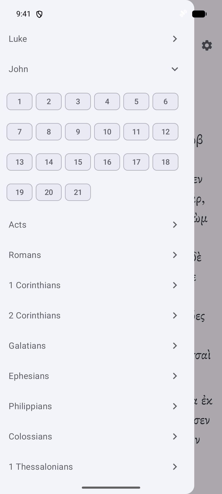

  

<h1 align="center">GNT Reader</h1>

  An Android app for reading the SBL Greek New Testament. Words outside your learned vocabulary appear in bold. Tap a word to see its meaning and grammar.

  <a href="https://github.com/jspann21/SBLGNT_Reader_App/releases/latest"><strong>Download for Android</strong></a>
  &nbsp;·&nbsp;
  <a href="https://github.com/jspann21/SBLGNT_Reader_App/issues">Feedback &amp; suggestions</a>

Android 7.0+ &nbsp;·&nbsp; Offline reading &nbsp;·&nbsp; No account required

  
  
  

Paragraph reading · Word details · Dark mode and verse-by-verse reading

## Reading

Read all 27 books in paragraphs or verse by verse. Swipe between chapters or use the book menu to choose a passage. The app saves your reading position.

Tap a word for its lexical form, English gloss, literal meaning, and grammatical parsing. Word details also include Strong’s and Louw–Nida references and vocabulary course chapters where available.

Reading and word lookup work offline. No account is required.

## Vocabulary

Enable a vocabulary list, such as Mounce or Smith, and select the chapter or lesson you’ve reached. Words covered by your selected levels appear in normal text; other words appear in **bold**. You can enable multiple courses and your personal list together.

Long-press a word and choose **Add to My Vocab** to mark it as learned. Enable the **User** list to use those words in highlighting and progress statistics. You can sort the list alphabetically or by date added, remove words, and export or import it as a file.

## Vocabulary progress

**Learning Progress** shows how much of the New Testament your active vocabulary covers:

- Overall coverage and learned lexical forms.
- Coverage from each course and your personal list.
- **Book Readability**, sorted by biblical order or vocabulary coverage.
- Coverage by part of speech and suggested words to learn next.

These percentages measure vocabulary coverage, not how much you’ve read.

  
  
  

Your vocabulary · Learning progress · Book readability

## Settings

| Setting | Options |
| --- | --- |
| Text size | Adjustable Greek text size |
| Line spacing | Compact, Cozy, or Spaced |
| Reading layout | Paragraphs or verse by verse |
| Text alignment | Justified or left aligned |
| Verse numbers | Show or hide |
| Book names | English or Greek |
| Proper nouns | Exclude from bold highlighting |
| Theme | Light, Dark, or System Default |

  
  
  

Reading preferences · Appearance · Book and chapter navigation

## Installation

1. Download the signed APK from the [latest release](https://github.com/jspann21/SBLGNT_Reader_App/releases/latest) and install it on an Android 7.0 or newer device.
2. Open the app and choose a book and chapter from the menu.
3. In **Settings → Vocabulary Systems**, enable your vocabulary lists and set your course level.

You can restart the guided quickstart from Settings at any time.

## Analytics and crash reports

The official release uses Firebase Analytics for usage statistics and Firebase Crashlytics for crash reports.

## About and credits

GNT Reader is developed and maintained by [jspann21](https://github.com/jspann21) / **Lex Apps**. [Report a problem or suggest a feature](https://github.com/jspann21/SBLGNT_Reader_App/issues), or email [lex340700@gmail.com](mailto:lex340700@gmail.com).

Text: **SBL Greek New Testament**, edited by Michael W. Holmes, copyright Society of Biblical Literature and Logos Bible Software. Morphological and lexical data: **MorphGNT**. Lexham-derived glosses and reference data: **Logos Bible Software**, from the **Lexham English Bible English–Greek Reverse Interlinear New Testament**. Greek font: **SBL Greek**, by John Hudson / Tiro Typeworks.

The original app code is [GPL-3.0-only](LICENSE). Text, data, and fonts retain their own terms; see the [full credits and third-party notices](THIRD_PARTY_NOTICES.md) and [authors](AUTHORS.md).

---

**Development:** [Building, configuration, and releases](docs/DEVELOPMENT.md)

**Contribute a vocabulary list:** [File format and instructions](vocabulary/README.md)
